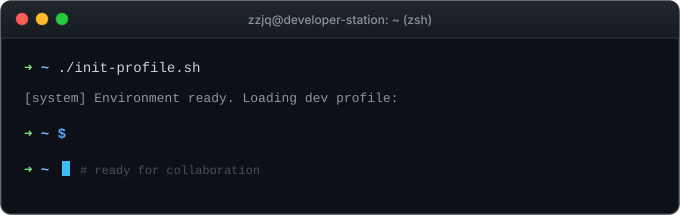

  <h1>Hi there, I'm zzjq 👋</h1>

  <!-- Terminal Window with Typewriter Effect -->
  

    
  

---

### 🤝 Connect with Me (联系方式)

  
  &nbsp;
  
  &nbsp;
  
  &nbsp;
  
  &nbsp;
  

  
<b>📱 Scan Telegram QR Code (点击展开 Telegram 二维码)</b>

   
  

    
  

